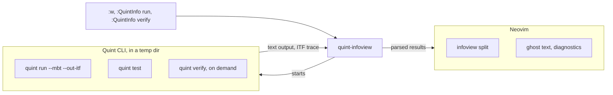

# quint-infoview.nvim

A side panel for [Quint](https://quint.sh) specs in Neovim, in the spirit of lean.nvim's infoview. Save a `.qnt` file and it runs `quint run` on the module under the cursor and `quint test` on the matching `_test.qnt`. The panel then lists each invariant as violated or held, each observation with how many traces reached it, and each test as passed or failed. When an invariant breaks, it shows the counterexample step by step, with the action taken and the variables it changed. `:QuintInfo verify` puts the result of `quint verify` (Apalache or TLC) in the same panel.

## Scope

- For one person editing Quint specs locally, with `quint` on `PATH`. Output parsing is tested against Quint 0.34.0 and 0.35.0.
- It is not a language server. Parse, type and effect errors keep coming from `quint-language-server`, and this plugin runs alongside it.
- It shows what Quint reports. A random simulation that finds nothing is evidence, not proof; use `:QuintInfo verify` for a bounded exhaustive check.

## Why it exists

The Quint language server and the VS Code extension cover writing a spec: diagnostics, hover, references. Nothing in the editor runs the spec, so checking an invariant means switching to a terminal and reading `quint run` output. This plugin adds:

- the run, test and verify results in a panel that follows the current Quint buffer;
- results beside each `invariant`, `observation` and `run` line, and failures as diagnostics;
- a counterexample view that highlights the action of the step under the cursor in the source.

## Commands and keys

- `:QuintInfo` or `:QuintInfo toggle`: open or close the panel.
- `:QuintInfo run`: run and test now (also happens on save).
- `:QuintInfo verify`: `quint verify` on the main module.
- `:QuintInfo main <module>`: pin the main module; `:QuintInfo main` unpins it.
- `:QuintInfo clear`: drop results for the buffer.
- In the panel: `<CR>` jumps to the invariant, observation, test, action or error under the cursor; `r` runs, `v` verifies, `q` closes.
- `:checkhealth quint_infoview` checks the `quint` version and `java`.

The main module is the module under the cursor. If that module has `const` parameters, it is the last module in the file without any.

## Install (lazy.nvim)

```lua
{
  url = "git@gh:g15ecb/quint-infoview.nvim.git",
  main = "quint_infoview",
  ft = "quint",
  cmd = "QuintInfo",
  opts = {
    cmd = { "quint" },
    run_args = {},
    test_args = {},
    verify_args = {},
    on_save = true,
    auto_open = true,
    width = 64,
  },
}
```

## How it fits together



- Each check runs the Quint CLI in a temporary directory; a new save cancels the previous check.
- The summary (which invariant failed, observation counts, test results) comes from Quint's text output; the counterexample comes from the ITF trace, with `--mbt` naming the action of each step.
- Nothing is cached between runs; the panel always shows the last completed check of the buffer.

## More

Layout, tests and fixture regeneration: [DEVELOPER.md](DEVELOPER.md).
